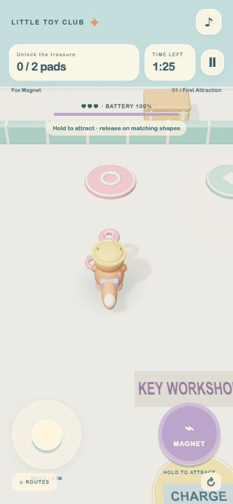

# Fox Magnet

A little fox solves magnetic key puzzles to find treasure. A standalone Little Toy Club game with soft rounded 3D art, an English start screen, 15 selectable levels, mobile portrait controls and saved best stars. Version 1.0.0.

**[Play online](https://wentaopeng714-cmd.github.io/fox-magnet/) · [Download the complete ZIP](https://github.com/wentaopeng714-cmd/fox-magnet/releases/download/v1.0.0/fox-magnet-v1.0.0.zip)**



## Play

Hold MAGNET to attract keys. Release above pads with matching colors and shapes. Fill all pads, then walk to the treasure chest. Glass keys stay on their rails.

On phones use the left joystick and right action button. On desktop use **WASD / arrow keys** and **hold/release Space**. **Escape** pauses. Retry includes a fresh countdown. Best stars are saved locally in your browser. Progression: Heavy keys, glass cases, four matching pads, battery management and dangerous magnetic iron balls.

## Run the downloaded game

Extract the ZIP, open a terminal in the `fox-magnet` folder, and run:

```sh
npm start
```

Requires Node.js. Open **http://localhost:4197/**. The compiled `game.js` is included, so no install or build is needed to play. `PORT` can override the default. Use a web server; opening `index.html` directly as a file is not supported. For static hosting, upload this folder intact. It boots directly into Fox Magnet, including when served at `/`.

## Source

```sh
npm install
npm run build
npm test
```

`src/main.js` manages menus and input; `src/sim.js` contains game rules; `src/view.js` builds models and animations; `src/audio.js` generates sound effects. These games share the Little Toy Club engine and catalog; the standalone entry selects this game's mode. All files needed to play or rebuild are included. Three.js is bundled under the MIT license in `THREE-LICENSE.txt`. Models are generated in code; there are no externally downloaded art assets.

## Verification

The shared engine passes 28 behavior checks. Simulation pilots have completed all 75 collection routes within their budgets using movement and action input. Run `node tests/route-pilot.mjs` for that additional check. Browser checks cover mobile layouts, level selection, starting, action release, pause, retry and result navigation. Actual phone performance and simultaneous two-thumb feel still need physical-device acceptance. This is a single-player game without online multiplayer.

Developer previews use `?verify=1`, optionally `&level=15`, `&demo=action&still=1`, `&demo=win` or `&demo=loss`. They never save progress. Normal URLs start at the normal menu.
